<!-- animated contribution graph: real public data for Utkarsha-pattern,
     boxes reveal once on load (regenerated daily by
     .github/workflows/update-profile-art.yml) -->

<h3><code>utkarsha@github ~ $ ./contributions.sh</code></h3>

 
 

<!-- ascii portrait (left) + streak/numbers card (right). both svgs are
     840x880 so equal widths give equal heights.
     portrait: python scripts/prep_photo.py source-photo.png && python scripts/make_ascii_svg.py
     stats:    python scripts/render_stats_svg.py (same daily workflow) -->

<h3><code>utkarsha@github ~ $ whoami</code></h3>

<table>
<tr>
<td valign="top"></td>
<td valign="top"></td>
</tr>
</table>

 
 

<h3><code>utkarsha@github ~ $ ./links.sh</code></h3>

Utkarsha Gupta · AI &amp; Product @Pattern

 

<!--
Portrait regeneration (after dropping a clearer headshot in as source-photo.png):

    pip install -r scripts/requirements.txt opencv-python-headless rembg
    python scripts/prep_photo.py source-photo.png
    python scripts/make_ascii_svg.py

Daily art (contrib-heatmap.svg, stats.svg, data/contributions.json) is rewritten
by .github/workflows/update-profile-art.yml. GitHub shows this README on the
profile page only while Utkarsha-pattern/utkarsha-pattern is public.
-->

